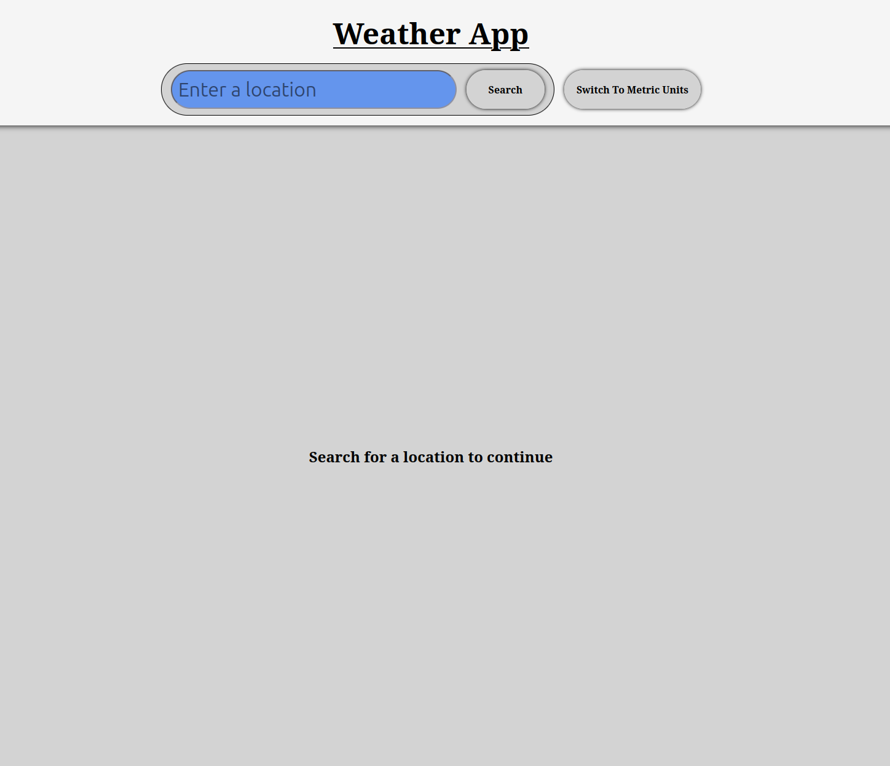
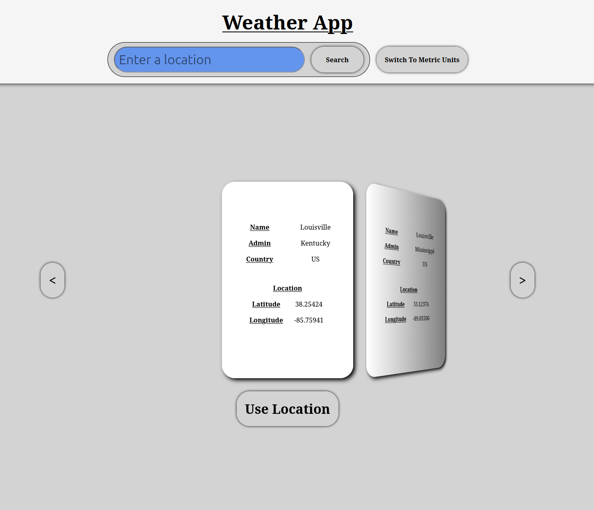
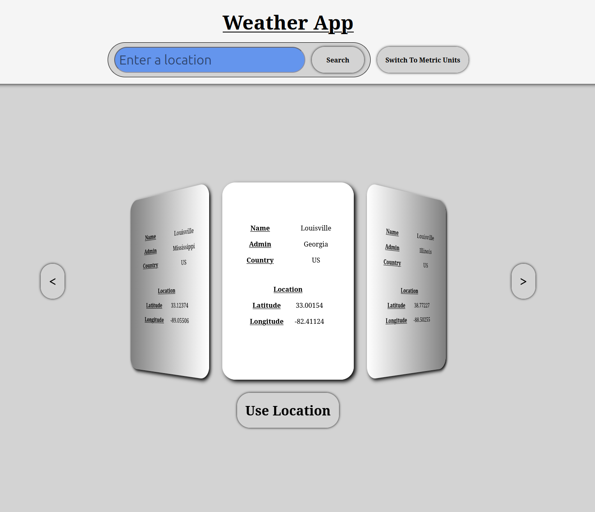
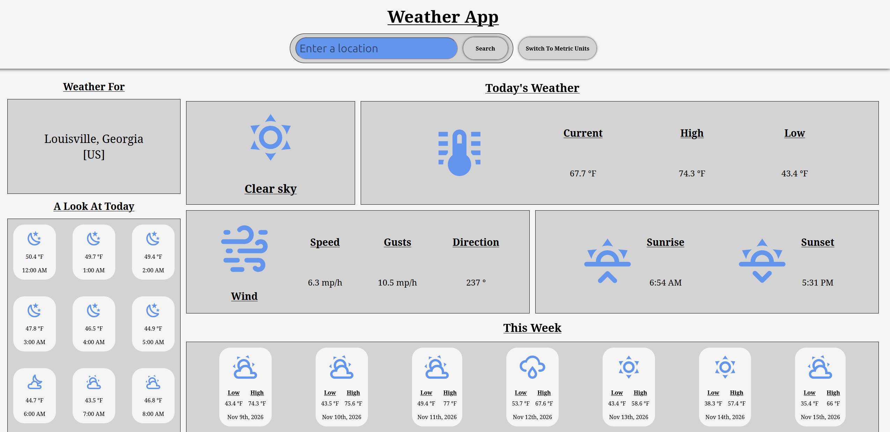

# Weather App

Here I have created a Weather App using HTML, CSS, and Javascript. This was done as a project for the The Odin Project curriculum. It uses the open-meteo api for both geolocation and weather reporting.

The user can search for their current location, and select the nearest result. The user is then given a report of the current, hourly, and daily weather for the selected location. The user should only have to set their unit preference once, as it is stored in local storage between sessions.

## Fututre Steps

- [ ] Make it look better...
- [ ] Add support for smaller screens
- [ ] Add ability for user to save location searches
- [ ] Add automatic updateing to results page (15 min. interval)

## Screen Shots

